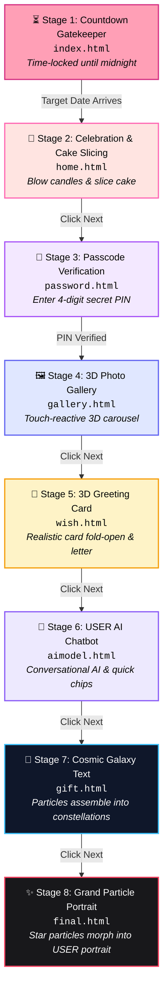

# 🎂 Interactive Birthday Celebration Web Experience 🎉

<div align="center">


<br/>

**A cinematic, multi-stage, interactive birthday surprise web experience handcrafted for a special USER.**
*Featuring 3D physics, particle synthesis, ambient audio soundtracks, secret PIN verification, interactive cake cutting, and an AI companion.*

[Explore Stages](#-the-interactive-user-journey) • [Quick Start](#-quick-start--local-preview) • [Firebase Setup](#️-firebase-configuration-important) • [Customization Guide](#-customization-guide-tailor-it-for-your-user) • [Deployment](#-deployment-guide)

</div>

---

## 🌟 Overview

This repository contains a production-ready, highly interactive personal celebration web app designed to surprise your special **USER** on their birthday. Rather than a static greeting card, this application takes the **USER** on a storytelling adventure across **8 sequential stages**—each unlocking only after engaging with the previous interaction.

### ✨ Key Features
- ⏳ **Anti-Cheat Countdown Timer**: Locks access until the exact birthday timestamp with `localStorage` state protection.
- 🎂 **Physics-Driven Cake Slicing**: Tap to blow out realistic candle flames, then grab a virtual knife to cut the cake.
- 🔐 **Secret PIN Lock**: 4-digit security verification screen with auto-focus shifting and animated toast feedback.
- 🖼️ **3D Perspective Photo Gallery**: Depth-tilt interactive photo carousel with fullscreen double-tap inspection.
- 💌 **3D Origami Birthday Card**: Physics-inspired greeting card with smooth 170° fold-open animation and heartfelt notes.
- 🤖 **Interactive AI Companion**: Dedicated conversational chatbot with ambient galaxy backdrop, floating hearts, and quick-reply chips.
- 🌌 **Cosmic Constellation Canvas**: Thousands of glowing particles assembling into celestial birthday messages.
- ✨ **Particle Portrait Synthesis**: Dynamic particle simulation where thousands of floating stars coalesce to recreate the **USER**'s portrait.
- 🎵 **Adaptive Multi-Track Audio**: Synchronized background music tailored to each emotional chapter of the journey.
- 📱 **100% Mobile First & Touch Optimized**: Handcrafted for seamless responsiveness on iOS and Android devices.

---

## 🗺️ The Interactive User Journey

The web experience follows a structured progression to build anticipation and emotion:



---

## 🎭 Stage-by-Stage Feature Breakdown

### 1. ⏳ Countdown Gatekeeper (`index.html`)
```text
+------------------------------------------------------+
|             🎉 COUNTDOWN TO CELEBRATION 🎉           |
|                                                      |
|   +----------+  +----------+  +----------+  +------+ |
|   |  00 Days |  | 00 Hours |  | 00 Mins  |  |00Secs| |
|   +----------+  +----------+  +----------+  +------+ |
|                                                      |
|                 [ 🎂 Access Now 🎂 ]                 |
|                                                      |
|          💞 The magic will bloom soon 💞             |
+------------------------------------------------------+
```
- **Real-Time Synchronized Clock**: Computes exact remaining days, hours, minutes, and seconds.
- **Tamper Resistance**: Stores unlock version in `localStorage` (`birthdayScriptVersion`).
- **Smooth Transition**: The "Access Now" button automatically pulses when the target time is reached.
- **Firebase Analytics Integration**: Configured with Firebase web SDK for page telemetry.

---

### 2. 🎂 Cake Celebration & Knife Slicing (`home.html`)
- **Animated Shimmer Header**: Dynamic gradient text with burst particles spawning every 2 seconds.
- **Interactive Multi-Tier CSS Cake**: Rendered entirely with pure CSS and SVG graphics.
- **Extinguishable Candles**: Four glowing flames that extinguish individually upon tap or click.
- **Physics Drag-to-Slice Knife**: Dragging the knife over the cake triggers custom cut animations and particle explosions.
- **First-Touch Audio Activation**: Bypasses browser autoplay restrictions seamlessly on candle interaction (`audio/song0.mpeg`).

---

### 3. 🔐 Secret Passcode Verification (`password.html`)
- **Digital Safe PIN Pad**: 4 separate digit inputs with automated next-field focus and paste listener.
- **Security Check**: Default PIN is set to `1626` (easily customized to any anniversary or birthdate).
- **Interactive Toast Alerts**: Green toast for access granted, red shaking toast for incorrect attempts.

---

### 4. 🖼️ 3D Perspective Photo Gallery (`gallery.html`)
- **3D Transform Engine**: Utilizes CSS `perspective`, `transform-style: preserve-3d`, and cosine falloff algorithms.
- **Mobile Gesture Support**: Touch-sliding moves through images in 3D perspective space.
- **Fullscreen Modal**: Double-tap on any image to open an immersive fullscreen viewer.
- **Atmospheric Track**: Background soundtrack (`audio/song1.mpeg`) starts on gallery interaction.

---

### 5. 💌 3D Origami Birthday Card (`wish.html`)
- **Realistic 3D Opening**: The greeting card rotates along the Y-axis (`-170deg`) with depth shadows when hovered or tapped.
- **Warm Poetry & Wishes**: Multi-paragraph heartfelt letter styled with classic serif typography.
- **Auto-Play Music**: Seamless audio triggers when opening the card.

---

### 6. 🤖 Romantic AI Companion (`aimodel.html`)
- **Canvas Galaxy Particle Simulator**: Over 30 floating glowing particles and soft crimson hearts floating upward.
- **Comprehensive Dialogue Engine**: Handles hundreds of friendly, playful, and caring messages with Bengali/English expressions.
- **Quick-Reply Suggestion Chips**: One-tap pills for instant conversation ("Hi 👋", "I'm bored 🥺", "Tell me a joke 😂", "Good night 🌙", etc.).
- **Audio Switcher**: Floating controller to toggle ambient background melody (`audio/song2.mpeg`).

---

### 7. 🌌 Cosmic Constellation Canvas (`gift.html`)
- **Galaxy Starfield Visuals**: Deep-space background (`img/september.jpg`) accented by falling shooting stars.
- **Dynamic Particle Formation**: Millions of particles scatter across the screen, then assemble into customized typography.
- **Ambient Track**: Accompanied by tranquil acoustic background melody (`audio/song3.mpeg`).

---

### 8. ✨ Grand Particle Portrait Finale (`final.html`)
- **Image-to-Particle Synthesis**: Reads the pixel data of the **USER**'s portrait photo and maps them to thousands of interactive canvas particles.
- **Gravitational Physics**: Particles react dynamically to mouse movement or touch coordinates before returning to their resting positions.
- **Calligraphic Typography**: Neon-lit golden birthday greeting with subtle sparkle animations.
- **Interactive Controls**: Features dedicated replay (`↻`) and audio toggle (`♪`) controls.

---

## ⚠️ Firebase Configuration Notice (Important!)

> [!IMPORTANT]
> The Firebase configuration included in `public/index.html` (and `public/home.html`) is a **DEMO / PLACEHOLDER configuration**.
> 
> Before deploying your project to production, **you must replace the demo configuration with your own Firebase project credentials.**

### How to insert your own Firebase configuration:

1. Go to the [Firebase Console](https://console.firebase.google.com/) and create a new project (e.g. `user-birthday-app`).
2. Add a new **Web App** (`</>`) to your Firebase project.
3. Copy the `firebaseConfig` object provided by Firebase.
4. Open `public/index.html` and locate the `<script type="module">` block at the bottom:

```javascript
// Replace this DEMO configuration with YOUR OWN Firebase credentials:
const firebaseConfig = {
  apiKey: "YOUR_OWN_API_KEY",
  authDomain: "YOUR_PROJECT_ID.firebaseapp.com",
  projectId: "YOUR_PROJECT_ID",
  storageBucket: "YOUR_PROJECT_ID.firebasestorage.app",
  messagingSenderId: "YOUR_MESSAGING_SENDER_ID",
  appId: "YOUR_APP_ID",
  measurementId: "YOUR_MEASUREMENT_ID"
};

// Initialize Firebase
const app = initializeApp(firebaseConfig);
const analytics = getAnalytics(app);
```

5. Also update the corresponding config block inside `public/home.html` if you intend to track analytics across both pages.

---

## 🛠️ Tech Stack & Architecture

| Technology | Purpose |
|:---|:---|
| **HTML5 / Semantics** | Accessible document structure with mobile viewport optimization |
| **Vanilla CSS3** | Custom 3D perspective transforms, flexbox, CSS grid, keyframe animations |
| **Vanilla ES6+ JavaScript** | Zero external dependencies or frameworks—lightweight, ultra-fast performance |
| **HTML5 Canvas 2D API** | Custom particle systems, gravitational math, star trails, pixel image mapping |
| **Web Audio API** | Multi-track audio management with browser autoplay policy workarounds |
| **Firebase Hosting** | High-speed global CDN hosting and fast SSL deployment |

---

## 📁 Repository Structure

```text
├── .firebaserc              # Firebase CLI project binding (Ignored in Git)
├── .gitignore               # Clean open-source ignore definitions
├── firebase.json            # Firebase hosting rules & public routing configuration
├── README.md                # Detailed project documentation
└── public/                  # Static assets & web application source
    ├── 404.html             # Custom fallback page
    ├── index.html           # Stage 1: Countdown Timer & Gatekeeper
    ├── home.html            # Stage 2: Celebration Cake & Candle Extinguish
    ├── password.html        # Stage 3: 4-Digit Passcode Safe
    ├── gallery.html         # Stage 4: 3D Perspective Photo Carousel
    ├── wish.html            # Stage 5: 3D Origami Birthday Card
    ├── aimodel.html         # Stage 6: AI Companion Chatbot Interface
    ├── gift.html            # Stage 7: Constellation Particle Synthesis
    ├── final.html           # Stage 8: Grand Particle Portrait Finale
    │
    ├── audio/               # Background soundtracks & audio assets
    │   ├── song0.mpeg       # Upbeat celebratory track for cake cutting
    │   ├── song1.mpeg       # Emotional acoustic track for gallery & card
    │   ├── song2.mpeg       # Lo-fi ambient melody for AI chatbot
    │   ├── song3.mpeg       # Ethereal cosmic soundtrack for gift & finale
    │   ├── song4.mpeg       # Auxiliary track
    │   └── song5.mpeg       # Auxiliary track
    │
    ├── css/
    │   └── styles.css       # Unified design system & responsive rules
    │
    ├── img/
    │   ├── cake.svg         # Cake vector illustrations
    │   ├── september.jpg    # High-resolution cosmic galaxy backdrop
    │   └── USER.jpg         # Recipient portrait image for particle engine
    │
    └── js/
        └── main.js          # Shared utility scripts & interactions
```

---

## 🚀 Quick Start & Local Preview

You don't need Node.js or any complex build tools to run this project! You can preview it with any static web server:

### Option 1: VS Code Live Server
1. Open this repository in VS Code.
2. Install the **Live Server** extension.
3. Right-click on `public/index.html` and select **"Open with Live Server"**.

### Option 2: Python Static Server
Run in PowerShell or terminal:
```bash
cd public
python -m http.server 8080
```
Then visit `http://localhost:8080` in your web browser.

### Option 3: Node `serve`
```bash
npx serve public
```

---

## 🎨 Customization Guide (Tailor it for your USER)

Follow these quick steps to make this project uniquely yours for your **USER**:

### 1. Set the Target Unlock Date
Open `public/index.html` (line 126) and update the `TARGET_DATE`:
```javascript
// Set to your USER's birthday (Year-Month-DayTHour:Minute:Second+Timezone)
const TARGET_DATE = new Date("2026-09-15T00:00:00+05:30");
```
*(Tip: To preview the site immediately during testing, change `diff <= 0` in line 171 to `true` or set the date to yesterday!)*

### 2. Update the Recipient Name
Search across the files in `public/` and replace instances of the name with your **USER**'s name:
- `public/index.html`: Header text `<title>` and `<h1>`
- `public/home.html`: Celebration banner
- `public/wish.html`: Letter body and salutation
- `public/final.html`: Final canvas portrait greeting line

### 3. Change the 4-Digit Passcode
Open `public/password.html` (line 230):
```javascript
// Choose any 4-digit code (e.g. birth date, anniversary)
const correctPassword = "1626";
```

### 4. Replace Photos & Portrait
Place your pictures in `public/img/`:
- **`public/img/USER.jpg`**: Portrait used for the particle reconstruction finale in `final.html`.
- **`public/img/september.jpg`**: Celestial background for the galaxy page in `gift.html`.
- In `public/gallery.html`, update the image URLs in the gallery links to display the **USER**'s favorite memories.

### 5. Personalize Background Audio
Place your preferred `.mp3` or `.mpeg` files into `public/audio/`. Keep the file names matching `song0.mpeg`, `song1.mpeg`, `song2.mpeg`, `song3.mpeg`, or adjust the `<source src="...">` tags in each HTML file.

### 6. Customize AI Chatbot Responses
Open `public/aimodel.html`:
- Customize the initial greeting message.
- Modify the conversational fallback arrays and rule responses in the `emojiReply()` function to include personal inside jokes and sweet nicknames.

---

## 🌐 Deployment Guide

### Deploying to Firebase Hosting (Recommended)

1. **Install Firebase Tools CLI**:
   ```bash
   npm install -g firebase-tools
   ```
2. **Log in to Firebase**:
   ```bash
   firebase login
   ```
3. **Initialize Firebase in this folder**:
   ```bash
   firebase init hosting
   ```
   - Select: *Use an existing project* (choose your newly created Firebase project)
   - What do you want to use as your public directory? `public`
   - Configure as a single-page app? `No`
   - Set up automatic builds and deploys with GitHub? `No`
4. **Deploy**:
   ```bash
   firebase deploy --only hosting
   ```
5. Your custom URL (e.g. `https://your-project.web.app`) is live and ready to be shared with the **USER**!

---

## 🛡️ Privacy & Security Best Practices

- **Personal Photos**: If publishing to a public GitHub repository, replace personal images in `public/img/` with sample placeholders, or add private image paths to `.gitignore`.
- **Protected History**: Make sure `.firebaserc` and local editor history `.history/` are never committed to your public Git tree.
- **Right-Click Shield**: Pre-configured context-menu preventers are enabled across pages to prevent casual image downloading during the surprise experience.

---

## 📄 License

This project is licensed under the [MIT License](LICENSE) — feel free to customize, adapt, and share it to celebrate someone special!

<div align="center">
  <sub>Made with ❤️ and cosmic stardust for your special USER.</sub>
</div>
